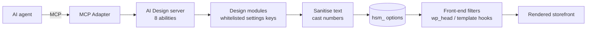

# AI Design — Storefront Look over MCP

   

**An MCP server that lets an AI agent change how a WooCommerce store looks — theme styles, homepage sections, colour palettes, product comparisons, variant swatches, add-ons and product video — without ever injecting HTML or code.**

8 tools. Every module is off by default and driven by a whitelist of settings keys. The agent can toggle and fill parameters, but text is sanitised and numbers are cast; it cannot write markup or PHP.

> 让 AI agent 改店铺外观：主题样式、首页区块、色卡、商品对比、变体色卡、附加选项、商品视频。AI 注入不了 HTML 或代码。

---

## What it can and cannot do

| Can | Cannot |
|---|---|
| Set theme style tokens (colours, fonts, radii, buttons) on block themes | Edit theme files or inject CSS/HTML |
| Compose homepage sections from core blocks | Write PHP or shortcodes |
| Generate palettes, trust badges, announcement bars, floating contact buttons | Install a page builder |
| Add comparison tables, variant swatches, product add-ons, product video | Change checkout logic or pricing rules |
| Apply front-end tweaks (free-shipping bar, sale badge, minimum order, maintenance mode) | Modify orders, customers or payments |

Global style tokens only affect **block themes**. Classic themes fall back to the Customizer, where these tools do not reach.

## Architecture



## Quick start

**Requirements:** WordPress 6.9+, PHP 8.0+, the official [MCP Adapter](https://wordpress.org/plugins/mcp-adapter/) plugin, and a **block theme** for the global style tools. Some modules need WooCommerce.

```bash
wp plugin install mcp-adapter --activate
wp plugin activate ai-design        # after copying this repo to wp-content/plugins/
wp mcp-adapter serve --server=ai-design --user=<admin-account>
```

Remote HTTP endpoint: `https://<your-site>/wp-json/ai-design/mcp` (authenticate with an application password).

### Verify in 60 seconds

1. Activate the plugin; confirm a server named `ai-design` appears in your MCP client.
2. Ask the agent to read `design` with no arguments — it returns the current palette and typography, and whether the active theme is a block theme.
3. Ask it to change one colour, then reload the storefront: the change must be visible without touching a single file.
4. Ask it to set the announcement bar text to `<script>alert(1)</script>` — it must come back sanitised. If it renders as markup, stop: that is a security bug.

## Tools (8)

| Tool | What it does |
|---|---|
| `design` | Global style tokens (primary/secondary colour, font, radius, button), announcement bar, floating contact button, trust badges |
| `store-tweaks` | Front-end tweaks: free-shipping progress bar, sale badges, add-to-cart copy, minimum order, quantity bounds, maintenance mode, checkout field visibility |
| `home-sections` | Homepage sections built from core blocks, still editable in the site editor |
| `compare` | Product comparison button and table |
| `swatches` | Variant swatches (colour / image / button) |
| `social-proof` | Urgency and social-proof elements |
| `product-addons` | Paid product add-ons |
| `product-video` | Product video (YouTube / Vimeo / direct URL) |

## Design notes

Most of these are **configure-once** features, not daily operations. The intended workflow is: the owner describes the look they want, the agent proposes a palette and a section layout, the owner iterates on the result — rather than the agent restructuring the storefront unattended.

## Sibling plugins

| Repo | Role |
|---|---|
| [aihand](https://github.com/baibiaowang/aihand-for-woocommerce) | Store operations — the day-to-day work |
| **aidesign** (this repo) | Storefront look — what this plugin does |
| [aitools](https://github.com/baibiaowang/aitools-for-woocommerce) | Store infrastructure — backup, mail, consent, pixels, cache |

All three share `hsm-core.php` and can be active together, each with its own namespace (`ai-design/`) and MCP server.

## Status

**v1.1.0 — development.** Verified against a local Docker store. **Not published on WordPress.org.** Modules are added as the store needs them, so expect missing features rather than bugs.

## License

GPL-2.0-or-later.
